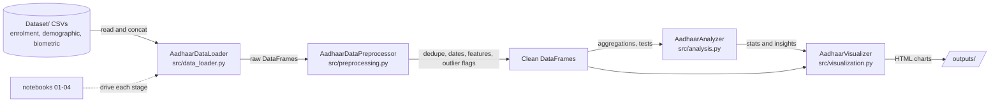

# IdentityLab

[](https://www.python.org/downloads/)
[](LICENSE)
[](https://jupyter.org/)
[](https://uidai.gov.in/)

> *Research-grade analytics for India's digital identity ecosystem*

IdentityLab is a data analysis pipeline for the UIDAI Aadhaar enrolment, demographic-update and biometric-update datasets (~5 million raw records). It cleans the data, runs statistical and geographic analysis, and produces interactive Plotly charts, to surface access and adoption patterns that can support evidence-based policy decisions. Built for the UIDAI Hackathon 2026.

**Privacy note:** the datasets are published aggregate counts per date, state, district and pincode. They contain no names, Aadhaar numbers or other personal records, and this repository adds none.

Docs: https://the-harsh-vardhan.github.io/IdentityLab/

## What it does
- **Automated data loading**: combine multiple CSV files per dataset, with optional Dask support
- **Preprocessing**: clean, validate and transform raw data with built-in quality checks and outlier detection
- **Statistical analysis**: univariate, bivariate and temporal analysis, seasonality detection, Gini concentration
- **Visualization**: interactive charts with Plotly, Seaborn and Matplotlib, including a multi-panel dashboard
- **Geographic analysis**: state, district and pincode level aggregation and choropleth mapping

## Architecture



## Key results
Figures come from the project notebooks and are detailed in [Key Findings](#key-findings).

| Metric | Value |
|---|---|
| Records analysed after cleaning | ~4.35 million |
| Duplicates removed | 591,180 (11.9% of raw data) |
| Date range | March 2025 - December 2025 |
| Geographic coverage | 50+ states/UTs, 950+ districts |
| Update-to-enrolment ratio | ~20:1 |
| Geographic concentration (Gini) | 0.74-0.77 |
| Interactive charts generated | 22 HTML files |

## Project Structure
```
├── Dataset/                          # Raw CSV data files
│   ├── api_data_aadhar_biometric/
│   ├── api_data_aadhar_demographic/
│   └── api_data_aadhar_enrolment/
├── notebooks/                        # Jupyter notebooks for analysis
│   ├── 01_data_exploration.ipynb
│   ├── 02_data_cleaning.ipynb
│   ├── 03_analysis.ipynb
│   └── 04_visualization.ipynb
├── src/                              # Source code modules
│   ├── data_loader.py
│   ├── preprocessing.py
│   ├── analysis.py
│   └── visualization.py
├── outputs/                          # Generated visualizations and reports (created on run)
├── requirements.txt                  # Python dependencies
└── README.md                         # This file
```

## Setup Instructions

### Prerequisites
- Python 3.9 or higher
- pip package manager

### Installation

```bash
# Clone the repository
git clone https://github.com/The-Harsh-Vardhan/IdentityLab.git
cd IdentityLab

# Create virtual environment
python -m venv .venv

# Activate virtual environment
# Windows:
.\.venv\Scripts\activate
# Linux/Mac:
source .venv/bin/activate

# Install dependencies
pip install -r requirements.txt

# Register Jupyter kernel (optional)
python -m ipykernel install --user --name=identity-lab --display-name "IdentityLab"
```

### Quick Start

```python
# Load data
from src.data_loader import AadhaarDataLoader

loader = AadhaarDataLoader('.')
df_enrolment = loader.load_enrolment_data()
df_demographic = loader.load_demographic_data()
df_biometric = loader.load_biometric_data()

# Preprocess
from src.preprocessing import AadhaarDataPreprocessor

preprocessor = AadhaarDataPreprocessor()
df_clean = preprocessor.clean_enrolment_data(df_enrolment)

# Analyze
from src.analysis import AadhaarAnalyzer

analyzer = AadhaarAnalyzer()
stats = analyzer.univariate_analysis(df_clean, 'total_enrolments')

# Visualize
from src.visualization import AadhaarVisualizer

viz = AadhaarVisualizer(output_dir="outputs")
fig = viz.plot_time_series(df_clean, 'date', 'total_enrolments', 'Enrolments Over Time')
```

### Running Notebooks
```bash
# Start Jupyter
jupyter notebook

# Open notebooks in sequence:
# 1. notebooks/01_data_exploration.ipynb
# 2. notebooks/02_data_cleaning.ipynb
# 3. notebooks/03_analysis.ipynb
# 4. notebooks/04_visualization.ipynb
```

## Modules

### `data_loader.py`
- Load and combine multiple CSV files
- Automatic data type detection
- Memory-efficient loading with optional Dask support

### `preprocessing.py`
- Data cleaning and validation
- Date normalization
- Outlier detection (IQR and Z-score methods)
- Feature engineering (temporal features, totals, ratios)

### `analysis.py`
- Univariate statistics (mean, median, skewness, kurtosis)
- Bivariate analysis (correlation, statistical tests)
- Temporal aggregation (daily, weekly, monthly)
- Geographical aggregation (state, district, pincode)
- Seasonality detection
- Growth rate calculation

### `visualization.py`
- Interactive time series plots
- Distribution analysis (histograms, box plots)
- Top N bar charts
- Correlation heatmaps
- Geospatial choropleth maps
- Seasonal pattern visualization

## Data Description
Each dataset is a set of CSV files with aggregate counts keyed by `date`, `state`, `district` and `pincode`.

### Enrolment Data (~1M records)
- New Aadhaar registrations by date, location and age group
- Columns: `date`, `state`, `district`, `pincode`, `age_0_5`, `age_5_17`, `age_18_greater`

### Demographic Update Data
- Demographic updates by date, location and age group
- Columns: `date`, `state`, `district`, `pincode`, `demo_age_5_17`, `demo_age_17_`

### Biometric Update Data
- Biometric updates by date, location and age group
- Columns: `date`, `state`, `district`, `pincode`, `bio_age_5_17`, `bio_age_17_`

## Key Findings

### Dataset Overview
- **Total Records Analyzed**: ~4.35 million (after cleaning)
  - Enrolment: 983,000 records
  - Demographic Updates: 1,596,358 records
  - Biometric Updates: 1,766,148 records
- **Data Quality**: Removed 591,180 duplicate records (11.9% of raw data)
- **Date Range**: March 2025 - December 2025
- **Geographic Coverage**: 50+ states/UTs, 950+ districts

### Activity Volume
- **Total Enrolments**: 5,331,661 new Aadhaar registrations
- **Total Demographic Updates**: 36,595,767 demographic changes
- **Total Biometric Updates**: 68,247,029 biometric captures
- **Update-to-Enrolment Ratio**: ~20:1 (updates significantly exceed new enrolments)

### Temporal Patterns
- **Strong Seasonality**: Coefficient of variation 109.75%
- **Peak Activity Month**: July 2025 (month 7)
- **Lowest Activity Month**: October 2025 (month 10)
- **Weekday Pattern**: Higher activity mid-week, reduced on weekends

### Demographics
- **Age Distribution** (Enrolments):
  - Age 0-5: 65.16% (3,474,307 enrolments) - Majority children
  - Age 5-17: 31.71% (1,690,892 enrolments)
  - Age 18+: 3.12% (166,462 enrolments)
- **Insight**: Aadhaar enrollment heavily focused on children, particularly infants (0-5 years)

### Geographic Concentration
- **Gini Coefficient**: 0.74-0.77 across all metrics
- **Interpretation**: High geographical inequality - activity concentrated in specific states
- **Top State**: Accounts for disproportionately high percentage of total activity
- **District Variation**: Top 20 districts account for significant portion of national activity

### Data Quality Metrics
- **Missing Values**: 0% (all fields complete after cleaning)
- **Invalid Dates**: <0.01% removed during preprocessing
- **Pincode Validation**: 100% conform to 6-digit format
- **Outliers Detected**:
  - Enrolment: 3.52% of records
  - Demographic Updates: 5.70% of records
  - Biometric Updates: 7.52% of records

### Update Behavior
- **Demographic Update Ratio**: Varies by state (0-2000%+)
- **Biometric Update Ratio**: More uniform distribution than demographic
- **Pattern**: Some states show extremely high update ratios, indicating data correction campaigns or policy initiatives

### Interactive Visualizations
- **22 HTML files** generated in `outputs/` directory
- Categories: Temporal trends, distributions, geographical maps, seasonality, age groups, update ratios, correlations
- **Comprehensive Dashboard**: Multi-panel overview combining key metrics

## Methodology

### 1. Data Exploration (Notebook 01)
- **Objective**: Initial profiling of ~5M raw records
- **Techniques**:
  - Schema validation and data type inference
  - Missing value analysis (0% missing found)
  - Duplicate detection (591K duplicates identified)
  - Date range validation (March-December 2025)
- **Outputs**: Data quality report, summary statistics, unique value counts

### 2. Data Cleaning & Preprocessing (Notebook 02)
- **Date Normalization**: Converted dd-mm-yyyy format to datetime64
- **String Cleaning**: Title-cased state/district names for consistency
- **Pincode Validation**: Zero-padded to 6-digit format
- **Numeric Conversion**: `pd.to_numeric()` with error coercion, filled NaN with 0
- **Total Calculation**: Summed age group columns to create totals
- **Zero-Row Removal**: Eliminated records with zero counts across all metrics
- **Feature Engineering**:
  - Temporal features: year, month, day_of_week, week_of_year, quarter
  - Derived metrics: total_enrolments, total_demo_updates, total_bio_updates
- **Duplicate Removal**: Dropped exact duplicates across all columns
- **Outlier Detection**: IQR method (threshold=3.0) for flagging anomalies

### 3. Statistical Analysis (Notebook 03)
- **Univariate Analysis**: Mean, median, std, skewness, kurtosis for all metrics
- **Temporal Aggregation**:
  - Monthly trends using `pd.Grouper(freq='M')`
  - Weekly/daily patterns for granular analysis
- **Seasonality Detection**:
  - Monthly average calculation
  - Coefficient of variation to quantify seasonal strength
  - Peak/low month identification
- **Geographical Aggregation**:
  - State-level: Sum, mean, count by state
  - District-level: Top N analysis
- **Concentration Analysis**:
  - Gini coefficient calculation (0.74-0.77)
  - Inequality measurement across geographical units
- **Update Ratio Calculation**:
  - (Total Updates / Total Enrolments) × 100 by state
  - Identified states with high correction activity
- **Age Group Breakdown**: Distribution analysis across 3 age cohorts

### 4. Visualization (Notebook 04)
- **Time Series Plots**: Plotly interactive line charts with `hovermode='x unified'`
- **Distribution Analysis**: Histogram + box plot combinations
- **Top N Bar Charts**: Horizontal bars for state/district rankings
- **Seasonality Patterns**: Monthly average line plots
- **Age Group Charts**: Pie charts and grouped bar charts
- **Correlation Heatmaps**: Plotly heatmap with annotated values
- **Multi-Panel Dashboard**: 6-panel comprehensive overview
- **Output Format**: All visualizations saved as standalone HTML files
- **Color Scheme**: Consistent `plotly_white` template throughout

### Data Pipeline
```
Raw CSV Files (5M records)
    ↓
Data Loading (AadhaarDataLoader)
    ↓
Data Cleaning (AadhaarDataPreprocessor)
    ↓  [Remove 591K duplicates, normalize dates, add features]
Clean Data (4.35M records)
    ↓
Statistical Analysis (AadhaarAnalyzer)
    ↓  [Univariate, temporal, geographical, seasonality]
Analytical Insights
    ↓
Visualization (AadhaarVisualizer)
    ↓  [22 interactive HTML charts]
Actionable Reports
```

### Key Analytical Techniques
- **IQR Outlier Detection**: `Q1 - 3×IQR` to `Q3 + 3×IQR` bounds
- **Gini Coefficient**: Measure of statistical dispersion (0=equality, 1=inequality)
- **Seasonality CV**: Standard deviation / mean × 100
- **Temporal Features**: ISO week extraction, day-of-week encoding
- **Aggregation**: Multi-level groupby operations (state → district → pincode)

### Code Architecture
- **Class-Based Design**: Separate classes for loading, preprocessing, analysis, visualization
- **Method Chaining**: Sequential processing through pipeline stages
- **Logging**: INFO-level logging for all major operations
- **Error Handling**: `errors='coerce'` for graceful handling of invalid data
- **Memory Optimization**: Optional Dask support for large datasets

### Validation Steps
- ✓ All pincodes 6 digits (100% compliance)
- ✓ No missing values in cleaned data
- ✓ Date range consistent across datasets
- ✓ Geographic coverage complete (50+ states)
- ✓ Temporal features correctly derived

## Technologies Used
- **Data Processing**: Pandas, NumPy, Dask
- **Statistical Analysis**: SciPy, Statsmodels, Scikit-learn
- **Time Series**: Prophet
- **Visualization**: Plotly, Seaborn, Matplotlib, Folium
- **Geospatial**: GeoPandas

## Team Members
Harsh Vardhan
Github : https://github.com/The-Harsh-Vardhan
Rakshit Modanwal
Github : https://github.com/Rakshit-2005


## Contributing
Contributions are welcome! Please feel free to submit a Pull Request.

1. Fork the repository
2. Create your feature branch (`git checkout -b feature/AmazingFeature`)
3. Commit your changes (`git commit -m 'Add some AmazingFeature'`)
4. Push to the branch (`git push origin feature/AmazingFeature`)
5. Open a Pull Request

## Acknowledgments
- UIDAI for providing the hackathon opportunity and datasets
- Open-source community for the amazing data science tools

## License
This project is licensed under the MIT License - see the [LICENSE](LICENSE) file for details.

---

**Note**: This project was developed for the UIDAI Hackathon 2026. The datasets used are for educational and analytical purposes.
