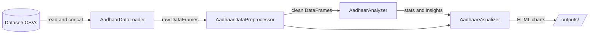

# Architecture

IdentityLab is a four-stage pipeline implemented as four classes in `src/`, driven by four notebooks in `notebooks/`.

## Components
| Component | File | Role |
|---|---|---|
| `AadhaarDataLoader` | `src/data_loader.py` | Loads and combines the enrolment, demographic and biometric CSVs, optionally with Dask |
| `AadhaarDataPreprocessor` | `src/preprocessing.py` | Date normalisation, string and pincode cleaning, duplicate and zero-row removal, temporal features, IQR outlier flags |
| `AadhaarAnalyzer` | `src/analysis.py` | Univariate and bivariate statistics, temporal and geographic aggregation, seasonality, growth rate, update ratio, concentration index |
| `AadhaarVisualizer` | `src/visualization.py` | Time series, distributions, top-N bars, heatmaps, choropleth maps, seasonal patterns, summary dashboard |

## Notebooks
1. `01_data_exploration.ipynb`: profiling, schema, missing values, duplicates
2. `02_data_cleaning.ipynb`: preprocessing steps
3. `03_analysis.ipynb`: statistics, seasonality, Gini, update ratios
4. `04_visualization.ipynb`: interactive charts and dashboard
